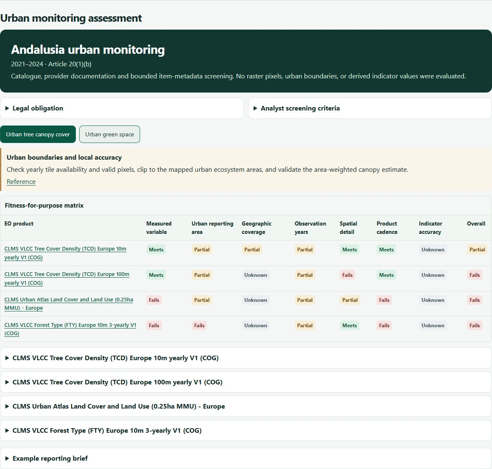
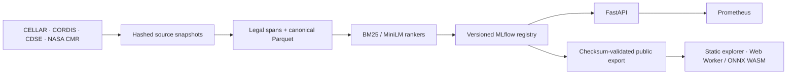

# EUPolicyEO

An evidence explorer and fitness-for-purpose assessment for EU environmental monitoring. The Andalusia case traces Article 20 of the EU Nature Restoration Regulation to two indicators, four Earth observation products, and the evidence gaps that remain. The explorer also searches Horizon Europe projects and EO catalogues.

[Article 20 assessment](docs/policy_assessment.md) · [Demo walkthrough](docs/demo.md) · [Deployment guide](docs/deployment.md) · [Verification](docs/verification.md)

Open **Assessment** to explore the Andalusia worked example. Switch between tree canopy and green space, then expand the 10 m Tree Cover Density row to inspect yearly catalogue samples. **Example reporting brief** shows how the local retrieval-augmented generation workflow summarises the evidence with citations. In the explorer, try **Pollinator abundance and diversity** to find CORDIS field-monitoring methods. [Copernicus product](https://land.copernicus.eu/en/products/high-resolution-layer-forests-and-tree-cover?tab=tree_cover_density) · [PollinERA project report](https://cordis.europa.eu/project/id/101135005/reporting)

## Browser explorer and local stack

The **browser explorer** is the portfolio demo. It answers questions like “Which research projects and Earth observation collections could help monitor urban tree canopy?” The **local Python stack** builds the data and search models that power it.

| | Browser explorer | Local Python stack |
| --- | --- | --- |
| **Where it runs** | GitHub Pages or the local Vite preview. Both serve the same browser app. | On your machine, either directly with Python or via Docker Compose. |
| **What you can do** | Start from an Article 20 provision or enter your own query. Choose keyword, semantic or hybrid search, filter collection extents on a map, and open source records. | Query search and recommendations through FastAPI. With a matching inventory loaded, check individual observation records (granules) for a bounded area and period. |
| **What it searches** | A versioned public subset with titles and selected metadata. | A richer normalized snapshot that can include project objectives and collection descriptions. |
| **How releases are made** | The browser loads the bundle and runs searches on your device. | Ingest and normalize source data, build and benchmark indexes, manage model versions in MLflow, monitor API requests with Prometheus, and export a new browser release. |

After staging and building the browser demo, `npm --prefix web run preview` serves it on your machine. The Python and Docker instructions below start the services and show how to rebuild a release. The two builds can return different rankings because their indexes use different records and fields. [Verified snapshot counts](#verified-results)



## Explore the evidence

1. Start with free text or choose an example button. **Vegetation cover** fills `fraction of green vegetation cover`. Open a candidate to inspect its available metadata. [Copernicus collection](https://land.copernicus.eu/en/products/vegetation/fraction-of-green-vegetation-cover-v2-0-1km)
2. Choose one of the ten Article 20(1) presets under **Search starting point**. The urban green space and tree canopy example opens the evidence for point (b). Open any collection or research project result to read its details in the explorer and follow the provider link. [Article 20](https://eur-lex.europa.eu/eli/reg/2024/1991/oj/eng#art_20)
3. Under **Collection filters**, set a date range or draw an area. Pan, zoom, pinch on touch screens, or search for a city before drawing. Enter decimal-degree coordinates for exact bounds.
4. Return to **Wetland restoration** and switch to **Semantic search** to see each result’s **Similarity score**. Open **Embedding map** for a two-dimensional view of the query and its results.

## How it works



### Legal text, embeddings and search

- **Legal extraction.** Rules identify monitoring obligations in Article 20 and preserve the exact source passage, its character offsets and any applicable lead-in. The extractor combines the monitoring topic and cited context into a candidate query.
- **Legal search presets.** Topic queries and documented metadata phrases narrow retrieval for both rankers. Source-documented measurements, methods and supporting context have labels and explanatory links. Timing and procedural clauses retain their legal evidence and can return an empty recommendation. Editing a preset query switches to free-text search.
- **Free-text evidence.** Keyword and semantic search check overlap on informative query terms before ranking. Public project records include a bounded vocabulary of methods and measurements mentioned in CORDIS objectives. The explorer can return an empty result list when the indexed evidence is too weak.
- **Keyword retrieval.** BM25 ranks normalized tokens using an inverted index. Term frequency, term rarity and document length influence the score. This mode is useful for exact terms such as product names, acronyms and legal phrases.
- **Browser hybrid retrieval.** **Hybrid search** uses reciprocal rank fusion to combine BM25 and MiniLM results for the published record fields. It runs in the browser with the same public data and model as the other search modes.
- **Passage retrieval.** The local discovery command separately retrieves titles, measurements, topics and source text with BM25 and MiniLM. Reciprocal rank fusion combines the best evidence passages for each record. The public browser indexes a constrained vocabulary from the provider’s measurement fields.
- **Semantic retrieval.** A pinned, pretrained `all-MiniLM-L6-v2` Transformer encoder maps record text and queries to 384-dimensional embeddings. The implementation uses attention-mask mean pooling and L2 normalization. Indexing precomputes vectors for records. At search time, ONNX Runtime encodes the query and an exact cosine scan ranks the stored vectors. The app returns ranked records grounded in their sources.
- **Filters and visualization.** Projects and EO collections have separate indexes and result lists. Collection filters check catalogue bounds and observation intervals. The embedding map uses PCA to project the current semantic query and its returned records into two dimensions. The ranking uses the original vectors.
- **Inventory identity and updates.** The local reconciler groups documented distribution formats, preserves source records, and distinguishes conflicting scientific versions and projections. A bounded refresh records what the new requests observed and their scope.
- **Local LLM extraction and RAG.** An optional local Ollama model drafts structured legal requirements or a reporting brief from retrieved evidence. Exact-span and citation checks reject invalid references. The generated legal extraction is evaluated against the rule-based baseline. [Reproduction and results](docs/policy_assessment.md#local-model-and-reporting-brief)

[Extraction code](src/eupolicyeo/requirements.py) · [Keyword retrieval](src/eupolicyeo/retrieval.py) · [Encoder](src/eupolicyeo/encoder.py) · [Model card](docs/model_card.md)

### Technology stack

| Area | Technologies | Role |
| --- | --- | --- |
| Acquisition | Python 3.12, httpx, lxml | Fetch and parse CELLAR legal text, CORDIS project data, Copernicus STAC and NASA CMR metadata. Record source revisions and SHA-256 hashes. |
| Data engineering | Pydantic, PyArrow, Parquet, DuckDB | Validate and normalize records, persist canonical tables and query snapshot counts. |
| Search and model runtime | BM25, MiniLM, Hugging Face Tokenizers, ONNX Runtime, NumPy | Build keyword indexes, encode text on CPU and rank embeddings by cosine similarity. |
| Local generation | Ollama, Pydantic, Qwen in the recorded evaluation | Extract cited legal requirements, review ambiguous catalogue pairs and produce reporting briefs from retrieved assessment evidence. |
| Browser app | TypeScript, Vite, Web Workers, Tokenizers.js, ONNX Runtime Web with WebAssembly, Natural Earth | Run keyword, semantic and hybrid search on the device and render catalogue footprints. |
| Serving and model operations | FastAPI, Uvicorn, MLflow with SQLite, Prometheus, Docker Compose | Serve search and bounded availability checks, promote and roll back versioned bundles, and monitor API requests. |
| Verification and delivery | uv, npm lockfile, Ruff, pytest, Vitest, Playwright, GitHub Actions | Reproduce builds, test Python and browser agreement, verify release checksums and prepare GitHub Pages deployment. |

See the [architecture guide](docs/architecture.md) for source adapters, artifact layout, runtime boundaries and configuration.

## Run it locally

Use Python 3.12, [uv](https://docs.astral.sh/uv/), and Node.js 24. For the full stack, start a local Docker engine.

### Preview a staged release

Use a Pages release archive and its recorded SHA-256. A source-only checkout can build a bundle with the registry commands in the next section.

```sh
uv sync --locked
uv run python scripts/prepare_pages.py --archive /path/to/eupolicyeo-pages.zip --sha256 "$ARCHIVE_SHA256"
npm --prefix web ci
npm --prefix web run build
npm --prefix web run preview -- --host 127.0.0.1
```

Open [the local explorer](http://127.0.0.1:4173/EUPolicyEO/). Vite serves it locally with the API stopped.

[Preview and staging options](docs/deployment.md#preview-the-static-explorer)

### Build from a fresh checkout

The demo ingests public sources, builds and benchmarks both rankers, and registers their versions locally.

```sh
uv sync --locked
docker compose up --build -d --wait mlflow
uv run eupolicyeo fetch-encoder
uv run python scripts/demo.py
```

The default profile requests the four Andalusia assessment products by ID. Use `uv run python scripts/demo.py --config configs/benchmark.yaml` for broader catalogue and project coverage.

Set `DENSE_VERSION` to the numeric dense version printed by the demo, then run the commands below. The deployment guide covers host-only deployment, PowerShell settings and custom ports.

```sh
uv run eupolicyeo promote --version "$DENSE_VERSION" --reason "Local demo" --allow-draft
docker compose up --build -d --wait api prometheus
uv run eupolicyeo export-pages --version "$DENSE_VERSION" --output artifacts/pages/from-registry
```

Open FastAPI, or stage the new bundle with `uv run python scripts/prepare_pages.py --bundle artifacts/pages/from-registry` before running the npm preview commands. Raw inputs, model files and generated releases live under `artifacts/`. [FastAPI](http://127.0.0.1:8000/docs) · [Deployment guide](docs/deployment.md)

## Verified results

The expanded source snapshot and browser release cover the following records.

| Source | Local snapshot | Static release |
| --- | ---: | ---: |
| [CELLAR / EUR-Lex](https://eur-lex.europa.eu/eli/reg/2024/1991/oj/eng#art_20) | 29 extracted entries | 29 entries |
| [CORDIS](https://data.europa.eu/data/datasets/cordis-eu-research-projects-under-horizon-europe-2021-2027?locale=en) | 10,000 projects | 1,000 projects |
| [Copernicus Data Space Ecosystem](https://stac.dataspace.copernicus.eu/v1/collections) | 242 collections | 200 collections |
| [NASA CMR](https://cmr.earthdata.nasa.gov/search/site/docs/search/api.html) | 499 collections | 200 collections |

- **Reproducibility.** Offline replay reproduced the canonical JSON and Parquet files byte for byte. A larger run processed 10,000 projects and 741 collections, with a separate inventory of 500 granules.
- **Serving and rollback.** The Compose deployment served registry versions `3 → 4 → 3`. Prometheus recorded a healthy scrape, the active model and a counted invalid request.
- **Search latency.** In the expanded local run, warm in-process p95 across 84 calls per ranker was 2.15 ms for BM25 and 6.69 ms for MiniLM on a Windows CPU. The timings cover ranking calls before HTTP transport.
- **Browser parity.** The revised browser release matched Python on 67 BM25 cases, including 22 legal-preset cases. MiniLM WASM matched Python’s top 10 across all 21 fixed probes. The earlier release was also verified with the API stopped. [Release checks](reports/release_checks.json)

Run the local unit checks with `uv run --locked pytest -q` and `npm --prefix web test` after installing dependencies. The deployment guide covers validation of a staged production build and the browser suite. [Verification](docs/verification.md) · [Deployment guide](docs/deployment.md)

## Scope and publication

The demo covers one English-language regulation article and bounded catalogue snapshots. Collection extents support initial filtering. Confirm acquisition availability with granule metadata and consult the regulation for legal interpretation. [Benchmark notes](docs/benchmark-notes.md)

The verification report records search quality, performance and release checks. The policy assessment report describes the known-record protocol. The free-text relevance comparison uses a separate question set and review procedure. [Policy assessment](docs/policy_assessment.md#search-changes-and-measured-results) · [Free-text comparison](docs/verification.md#search-quality) · [Model card](docs/model_card.md)

The Pages deployment workflow builds from a checksummed data archive and verifies that it matches the selected commit. [Publishing guide](docs/deployment.md#publish-after-approval)

## License

Original project code and documentation are available under the MIT License. Third-party catalogue data, legal text, models and browser dependencies retain their respective terms. [MIT License](LICENSE) · [Data sources and third-party terms](docs/data_sources.md)
