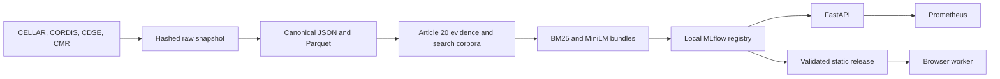

# Architecture

EUPolicyEO turns official legal text and catalogue metadata into two search corpora. The local stack covers acquisition, indexing, deployment and operational checks. The static explorer packages a curated subset of the same workflow for browser use.

## Acquisition and evidence

[Source adapters](../src/eupolicyeo/sources.py) bound requests, validate pagination destinations and record response metadata and SHA-256 digests. Each snapshot keeps the raw payloads and its manifest under `artifacts/snapshots/<snapshot_id>/`. [Normalization](../src/eupolicyeo/normalization.py) verifies the snapshot files before writing canonical JSON and Parquet. The normalized table counts and duplicate checks are reproducible with `query-parquet`.

[Extraction](../src/eupolicyeo/requirements.py) preserves the act section, exact legal substring, character offsets and applicable lead-in. Requirement IDs connect the selected legal evidence to a candidate search. Research projects and EO collections keep distinct IDs, indexes and result lists.

## Registry, API and metrics

[Bundles](../src/eupolicyeo/bundle.py) tie search data and index files to the source snapshot, ranker and build manifest. MLflow assigns an exact numeric model version. FastAPI resolves the `champion` alias at startup and exposes the loaded version at `/version`. Moving the alias and restarting the API changes which verified bundle is served. Prometheus records request, retrieval and ingestion signals using bounded labels. [Local deployment](deployment.md#run-the-python-stack)

Registered bundles run through the ranking code installed in the API process. Alias rollback restores the selected snapshot, indexes and encoder under that engine. To reproduce a historical code change, run the matching source checkout or container with the corresponding bundle.

The local `/availability` endpoint evaluates a bounded granule inventory for the loaded snapshot. Collection search uses catalogue bounds and documented observation intervals. See the [data notes](data_sources.md#coverage-and-availability) for the difference in scope.

## Browser runtime

[Publication](../src/eupolicyeo/publication.py) applies a public field allowlist and caps before rebuilding the indexes. The release manifest identifies the parent snapshot and registry version, the public corpus hash and each asset's digest. Staging verifies the archive or bundle, size and file inventory before making one release active.

The TypeScript worker runs BM25 and, for a semantic release, pinned MiniLM with ONNX Runtime Web. It loads data and model assets from the site's origin. The map uses bundled Natural Earth geometry and places. Text queries, geometry and retrieval stay in the browser. An opened source link goes directly to its publisher. [Model card](model_card.md) · [Static release setup](deployment.md#preview-the-static-explorer)

## Configuration

| File or variable | Purpose |
| --- | --- |
| [`configs/demo.yaml`](../configs/demo.yaml) | Legal scope, acquisition bounds and MiniLM settings for a demonstration |
| [`configs/benchmark.yaml`](../configs/benchmark.yaml) | Larger bounded metadata acquisition |
| [`configs/pages.yaml`](../configs/pages.yaml) | Public subset caps, size budget and dense export setting |
| `EUPOLICYEO_ARTIFACTS` | Workspace data directory, default `artifacts/` |
| `MLFLOW_TRACKING_URI` | Registry endpoint used by host CLI and API |
| `PAGES_BASE` | Static site path used by the build and browser tests |
